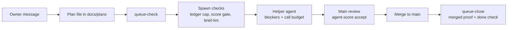

# neurastream

Guardrails for running many AI coding agents at once.

One "main" agent plans the work and reviews it; cheaper "helper" agents do the coding. neurastream is the set of checks between them. It keeps a queue of written plans, refuses helper actions a plan forbids, limits how many helpers run per provider, scores each helper by accepted work per dollar, and only lets a plan leave the queue once its branch is really merged.

The core does not depend on one agent tool. Adapters translate a tool's events into core calls. The first adapter is [omp](https://github.com/can1357/oh-my-pi).

A step-by-step visual walkthrough (50 steps, plain language) is in [docs/visual/neurastream-deck.html](docs/visual/neurastream-deck.html). Download it and open it in a browser.



## What it does

| Part | What it enforces |
|---|---|
| Queue (`queue-check`, `queue-close`, `queue-cancel`) | Every open plan is listed in an index and follows a template. A plan leaves the queue only when its branch is merged into remote main and its done check passes; a failing check reopens it. A cancelled plan's unmerged work is saved under `refs/queue-archive/`. |
| Blockers | Each plan's phase 0 lists what helpers may not do: push, touch a path, run a command, or write a text. The guard judges the command that runs and the files it changes, not words inside commit messages, quoted text or heredoc bodies: `git commit -m "... push ..."` is allowed, `git push` is refused. |
| Guards | Helpers may only edit their plan's `## Progress`; they get a warning at call 90 and are stopped at call 100. Protected files need an owner unlock (a file the owner touches, valid 30 minutes). |
| Ledger (`agent-ledger`) | Tokens, cost, state and exit reason per agent; `--cap` refuses a spawn when a provider already runs 2. |
| Scoring (`agent-score`) | Points only for work Main accepted by commit, times the phase difficulty. Ranked per dollar and per hour. |
| Brief lint (`brief-lint`) | Refuses a helper brief that misses a required rule (acceptance, stop condition, no push, call budget). |
| Machine health (`machine-guard`, `main-start`, `heavy-run`) | Load, free memory, disk and `/tmp` limits; one heavy test run at a time. |
| Unlanded work (`wip-check`, `wip-snapshot`, `wip-backup`) | Lists branches on no remote and dirty worktrees; snapshots them as hidden commits; can push them to a backup repo. |
| Session rollover | When the main session file passes 5 MB, the next owner message starts a fresh session from a handoff note. |

## Requirements

- [Bun](https://bun.sh) 1.x
- git
- omp, for the guards and rollover (the command-line tools work without it)

## Install

```sh
bun add -g neurastream
neurastream init
neurastream adapter install omp
neurastream doctor
```

`init` writes `~/.config/neurastream/config.yml` from the defaults in [docs/config.md](docs/config.md), plus an empty index, notes, the queue template, blocker wrappers, and the state directories. A second run changes nothing. `adapter install omp` links the extension (`~/.omp/agent/extensions` and `omp plugin link`). `doctor` exits 0 when the install matches the package.

The defaults are the author's setup (paths, the backup repo, provider names). Edit `config.yml` before relying on them. To try it without touching your real home, set `HOME=/tmp/neurastream-home-dev` first.

Check the merged result:

```sh
neurastream config --json
```

Every tool is one program, selected by the name it was called with: `agent-score`, `agent-ledger`, `brief-lint`, `oc-run`, `wip-check`, `wip-backup`, `wip-snapshot`, `pm-fail-facts`, `main-health`, `queue-check`, `queue-close`, `queue-cancel`, `main-start`, `machine-guard`, `glm-reset`, `priority-watch`, `resource-alerts`, `tmp-snapshot`, `heavy-run`.

## Develop

```sh
bun install
bun run typecheck
bun test
```

Green is both exiting 0.

## Scoring details

`agent-score accept` records accepted work by commit; `agent-score validate <Agent> --plan <plan.md> --phase <P> --evidence <report.md> --section "<heading prefix>"` records a validation phase (checks/tests ran, report section written, no commits) with proof Main cannot fake by typing: the plan line must be ticked `- [x]`, the cited section body must name a heavy-run label run by that agent (from `paths.heavy_log`), and the phase must not be scored already. The ranking board counts it in `Accepted (diag/val)` as `N (d/v)`.

## Main reads the code for its plans

Owner rule: never write a plan when another agent is doing the research or reading for you. When Main writes a plan, Main reads the relevant code itself and lists those files in the plan.

- Logged: every non-`task` call Main makes adds the paths it touches to `main-reads.json` in the queue state dir (`paths.queue_state`), with the time. A `grep -n` result adds each file it names (`path:line:` at a line start), resolved against the call's directory.
- Window: `guards.plan_read_max_hours` (default 24, `docs/config.md`). Every file listed under `## Code read by Main` must exist and have a logged read within that many hours. A backticked path cited elsewhere in the plan, outside `docs/plans/`, must also be listed there.
- Cutoff: plans whose filename stamp is `20261021_0100` or later must carry a non-empty `## Code read by Main` section. Older plans are grandfathered.
- Retention: entries older than 7 days are dropped on each write.
- Spawn briefs: a brief must name an unticked phase id of the plan (for example `P4`). A brief that asks for research for a plan to be written is refused, quoting the owner rule.

## Queue holds

A plan parked for the owner has one line: `WAITING on owner: <what>`. That line is the only hold, and only Main writes it (plan-guard refuses subagents). The queue summary shows it as a flag on the plan, cut at 80 characters. Compaction and the rollover handoff read the same lines through `ownerHolds`: the compaction context lists each `<plan file>: WAITING on owner: <text>` line (or `none`) and says any other "needs the owner" or "paused" claim is unverified; the handoff's generated state carries the same lines. Main does not keep holds in a handoff note.

## Session rollover

Main's session file grows with every turn. When it reaches `rollover.max_session_mb` (default 5, `docs/config.md`), Main writes a handoff note to `<queue_state>/rollover/<session id>.md`. The note covers the work in progress and its state, the decisions made and why, the next step, and the files involved. Main is asked for it once per session file, when a turn ends.

There are two modes:

- Under `neurastream main` (the launcher) the rollover is automatic. Once the note is written and no own jobs (subagents included) are still running, omp writes `relaunch.json` and exits. The launcher starts a fresh omp whose first message is the handoff: the note verbatim, the generated `main-start` state (including the owner holds), the owner's unsent draft if there is one, and a line that the owner is away. Nobody types anything. A handoff over 100000 bytes goes to `<queue_state>/rollover/<session id>.handoff.md`, and the first message points at that file.
- Under plain `omp` the switch is never automatic. The owner's next plain message closes the session and starts a fresh one; the fresh session opens with the note verbatim, the generated state, and then the owner's message.

A relaunch keeps the flags of the first run (`--model`, `--session-dir`, …) and drops only the first message and the session-picking and one-shot flags (`-r`, `-c`, `--restore`, `--goal`, `-p`, …), so the fresh omp stays on the same model and session directory.

In both modes:

- A note counts only if it was written after the threshold was crossed and is at most one hour old.
- The running plugin going stale counts as over the threshold too: at every check the adapter re-reads the `package.json` it was loaded from, and a different (or unreadable) version asks for the handoff note even below `rollover.max_session_mb`, naming both versions (`NEURASTREAM_PACKAGE_JSON` overrides the path it watches).
- While a rollover is pending (no fresh note, own jobs still running, or the handoff is ready and waiting for idle), Main cannot start new subagents: a `task` call is refused until the running jobs finish and the session rolls over.
- While own jobs (subagents included) are still running, the switch waits: a rollover would cancel them.
- `/main-rollover <message>` does the same by hand. It refuses below the threshold, without a fresh note, or while jobs run. Under neurastream main it is refused and the owner's next message starts the rollover; in plain omp a second call while one waits adds its text to the same handoff.
- `/main-rollover` shows a notice at once and gathers `main-start` in the background, so omp keeps repainting and reading keys until the new session opens.
- The previous session file stays where it is.
- `rollover.enabled: false` turns the feature off.

## Self-metrics

`neurastream metrics report [--days N]` compares this window (the last `metrics.report_days`, default 7) with the one before it, writes `<paths.notes>/metrics.md`, and prints the same report. Worst change is marked `◀ worst`. The five numbers:

- M1 cost per merge: cost of sub and main runs written in the window, divided by accepts in the window. Worker-only and Main-only dollars are shown too.
- M2 idle calls: calls of finished or died sub runs in the window that never got an accept, diagnose or validate event. Top 3 shown.
- M3 CI tries: mean `tries` of `ci` events in the window, and the MRs at 3 or more tries. Tries come from `metrics.ci_pipelines_cmd` (see `docs/config.md`).
- M4 owner corrections: owner messages in main runs that match `metrics.correction_patterns`, and Main messages ending in `?`. The owner message count is shown but never ranked.
- M5 guard blocks: BLOCK lines in the guard logs in the window, with false alarms and the top 3 reasons.

Caveat: M4 is a whole-run measure. A main run counts entirely by its last write time, so a run that spans a window edge counts in the window it ends in.

Weekly loop: run `neurastream metrics report`, then propose ONE rule change to the owner. When the owner decides, record it with `neurastream metrics rule "<text>" --approved|--rejected`; approved rules get a before/after check once a full window has passed. Record CI with `neurastream metrics ci <repo-dir> <mr-id>` and guard false alarms with `neurastream metrics false-alarm <log-ts> --why "<text>"`. main-start shows the report as due when it is missing or older than `metrics.report_days`.

## Self-improvement

Bugs in neurastream itself are found by code, written to a persistent list, and pushed on Main until each one has a plan or a recorded dismissal — not remembered. The list is `<paths.queue_state>/incidents.jsonl`; `neurastream incident list [--open] [--json]` reads it.

Four sources feed it:

- Real time (at Main's prompt and after each Main bash result): a finished subagent the agent-ledger still shows RUNNING/WAITING past `incidents.contradiction_grace_min` (D1); a neurastream tool that crashed in a Main bash result (D2); the same guard block firing `incidents.block_repeat` times within one hour (D3); an owner message matching `metrics.correction_patterns` (D4). D2 and D4 run on every event; D1 and D3 read the session files and the guard logs at most once per `incidents.scan_interval_sec` (state: `incident-scan.json` in the queue state dir).
- Daily: at the first main-start or Main prompt of a day, M1-M5 for the last 24 hours against the mean of the 7 days before; a metric worse by `incidents.daily_worse_pct` and above its `incidents.daily_floor` floor is an incident.
- Weekly: when the metrics report is due, the code writes `<paths.notes>/metrics.md` itself and its worst ranked metric becomes an incident.
- Main itself: `neurastream incident add "<summary>" --kind <k>`.

While an incident is open (no plan, dismissal or fixed record), every Main prompt carries one `INCIDENT <id> [<source>/<kind>]: <summary>` line per open incident, Main's `task` spawns and bypass launches are refused unless the brief names a plan citing `INCIDENT <id>`, and Main cannot stop with an incident that has neither. The loop closes three ways: `neurastream incident plan <id> <plan.md>` (the plan must exist, be listed in its repo INDEX, cite `INCIDENT <id>`, and carry a fail-before phase — its regression test has to fail on the old code), `neurastream incident dismiss <id> --why "<text>"`, and `fixed` — written by the queue itself when it closes a plan that cites the incident. `neurastream metrics report` shows M6: incidents opened / planned / dismissed / fixed and the median hours from open to fixed.

## Changing a script

Edit the script in this repo. Green is `bun run typecheck` and `bun test`, both exit 0. Main tags the release. The publish workflow puts that tag on npm. Then:

```sh
bun add -g neurastream@latest
neurastream adapter install omp
```

Live copies are never hand-edited. `neurastream doctor` names each hand-edited or foreign installed file, and a stale install (the installed version is not `npm view neurastream version`). If the registry cannot be reached, that check is a warning, not a failure.

## License

MIT. See [LICENSE](LICENSE).
