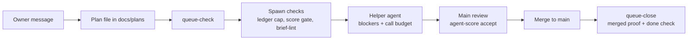

# neurastream

Guardrails for running many AI coding agents at once.

One **Main** agent plans the work and reviews it; cheaper **helper** agents do the coding. `neurastream` is the deterministic check layer between them: it keeps a ranked queue of written plans, blocks forbidden helper actions, caps concurrent helpers per provider, scores helpers by accepted work per dollar, and only closes a plan once its branch is actually merged.

The core is harness-agnostic (`src/core/` never imports a harness). Adapters translate a tool's events into core guard calls, or any hook-capable harness can call `neurastream guard <event> --json`. The first adapter is [omp](https://github.com/can1357/oh-my-pi).

A step-by-step visual walkthrough (50 steps, plain language) is in [docs/visual/neurastream-deck.html](docs/visual/neurastream-deck.html).



## Quickstart

### Requirements
- [Bun](https://bun.sh) >= 1.0 (Linux or macOS)
- `git`
- `omp` (for the live extension hooks and session rollover; standalone CLI tools work without it)

### Install

Guided one-command setup (detects your machine, prompts for settings, installs the `omp` adapter, runs `doctor`):

```sh
bun add -g neurastream
neurastream setup        # or: neurastream setup --yes
```

Manual setup:

```sh
neurastream init --allow reviewer,coder
neurastream adapter install omp
neurastream doctor
```

To try it without touching your real home directory, set `HOME=/tmp/neurastream-home-dev` first. Inspect the merged config anytime with `neurastream config --json`. To remove everything cleanly: `neurastream uninstall --purge`.

### Running Main vs. plain `omp`

`neurastream` hooks only activate under `neurastream main` (which sets `NEURASTREAM_MAIN_LAUNCHER=1`). Plain `omp` runs untouched with no guards, queue summary, or rollover.

```sh
neurastream main         # Main: guards, queue, rules, rollover
omp -p "say hi"          # plain omp: no neurastream hooks
```

Put your own Main-only instructions in `MAIN.md` inside `paths.agent_dir` (default `~/.config/neurastream/MAIN.md`, or `~/.omp/agent/MAIN.md` when configured).

### First 5 minutes

1. **Create a plan** in your repo's main checkout (`<repo>/docs/plans/YYYYMMDD_HHMM_topic.md`) using `templates/queue/TEMPLATE.md` (with `## Goal`, `## Forbidden`, `## Blockers`, `## Phases`, `## Done check`, `## Code read by Main`, and `## Progress`).
2. **Add it to the queue index** (the index file is `0444` on disk; agents write to it only via `queue add` / `queue move`):
   ```sh
   neurastream queue add /abs/path/to/repo/docs/plans/20261120_1200_topic.md
   ```
3. **Validate the queue**:
   ```sh
   queue-check
   ```
4. **Start Main**:
   ```sh
   neurastream main
   ```
   Main sees the ranked queue, spawns helpers inside your provider caps and blockers, reviews their work, merges, and `queue-close` archives the plan once git proves the branch landed and the done check passes.

## Features

### Core guardrails

| Feature | What it enforces | Docs |
|---|---|---|
| **Plan queue** (`queue-check`, `queue-close`, `queue-cancel`, `queue-finished`, `queue-trim`) | One flat ranked `INDEX.md` (priority = line order, `0444` on disk). One plan = one worktree. Closes only when git verifies the branch landed (merge, squash, or rebase) and `## Done check` passes. | [docs/guards.md](docs/guards.md#plan-queue) |
| **Blockers & guards** | Per-plan phase-0 blockers (`no-push`, `deny-path`, `deny-command`, `deny-text`). Helpers may only edit `## Progress` (with `Findings:` lines), hit a call budget (warn 90 / stop 100, overridable via `Call budget: N`), and cannot touch protected files without an owner unlock. | [docs/guards.md](docs/guards.md#blockers-and-guards) |
| **Review, read & brief gates** | Requires `## Code read by Main` (verified against logged reads), `## Reuse`, a read-only reviewer `PLAN REVIEW: PASS` (and optional `CODE REVIEW: PASS`), and `brief-lint` checks before spawning helpers. | [docs/guards.md](docs/guards.md#review-read-and-brief-gates) |
| **Autonomy tiers & planner mode** | Switch Main between `tier strict\|opinionated\|full` (edit caps, push approval via `go push`, call caps) and `planner main\|delegated` via chat or config. | [docs/guards.md](docs/guards.md#autonomy-tiers-and-planner-mode) |
| **Ledger & scoring** (`agent-ledger`, `agent-score`) | Tracks tokens, cost, and status per run; caps concurrent runs per provider (`ledger.max_running_per_provider`), enforces preferred pick order (`ledger.prefer`), and ranks agents by accepted work per dollar/hour. | [docs/traces-and-metrics.md](docs/traces-and-metrics.md#scoring-and-ledger) |
| **Secret redaction** (`neurastream redact`) | Redacts known machine secrets (env vars, `.env`, `~/.npmrc`, webhooks) and token shapes from every tool result and outbound notification before the model or logs see them. Optional `secretgate` proxy support. | [docs/operations.md](docs/operations.md#secrets-redaction) |
| **Machine health** (`machine-guard`, `heavy-run`, `neurastream pressure`) | Load/memory/disk/`/tmp` gates, single-slot `heavy-run` test lock, and Linux PSI pressure alerts. | [docs/operations.md](docs/operations.md#machine-health-and-pressure) |

### Optional capabilities

| Feature | What it gives you | Docs |
|---|---|---|
| **Owner phone page** (`neurastream workspace`) | Single-user Tailscale-only web UI (Now, Queue drag-reorder, Agents, Spend, Base, Results) with Host/Origin DNS-rebinding checks and owner inbox delivery. | [docs/workspace.md](docs/workspace.md#owner-page) |
| **Static pages & plan approval** (`neurastream pages`, `notes`, `diagram`) | Tailnet static HTML hosting with inline review notes, architecture-drilldown checks, and hash-bound plan approval. | [docs/workspace.md](docs/workspace.md#static-pages-and-plan-approval) |
| **Multi-Main & Team queue** (`neurastream claim`, `team`) | Run multiple Mains on one personal queue with 30-min heartbeat claims, or share `Queue: team` plans over a team Tailscale SQLite server. | [docs/guards.md](docs/guards.md#several-mains) · [docs/team-server.md](docs/team-server.md) |
| **Session rollover & rate limits** | Auto-rolls Main into a fresh session with a handoff note past 5 MB or on plugin upgrade; probes provider 429s and resumes Main automatically when capacity returns. | [docs/operations.md](docs/operations.md#session-rollover) |
| **Continuous watch & notifications** (`neurastream watch`, `notify`) | Background systemd/launchd timer checking job heartbeats, failed units, CI pipelines, and release verdicts; posts Main replies and alerts to Discord/Slack webhooks. | [docs/operations.md](docs/operations.md#continuous-feedback-watch) |
| **WIP safety net** (`neurastream wip`) | Hourly hidden-ref git snapshots (`refs/wip/...`) and nightly push to a verified-private backup repo. | [docs/operations.md](docs/operations.md#saving-unsaved-work-wip) |
| **Trace forensics, metrics & self-pruning** (`traces`, `labels`, `metrics`, `incident`, `rules`) | Audits unbacked claims, suspicious actions, provider honesty, prompt bloat, and wasted calls; tracks weekly `M1`–`M5` metrics, opens incidents, and tunes noisy rules down automatically. | [docs/traces-and-metrics.md](docs/traces-and-metrics.md) |
| **Conversation recall** (`neurastream recall`) | Append-only redacted log of owner messages and Main answers with word search and optional LLM topic segmentation. | [docs/operations.md](docs/operations.md#recall) |
| **Reuse map** (`neurastream reuse on`, `map`, `off`, `status`) | Opt-in per-repo graphify map that the plan write gate reads, so a `## Reuse` section cites existing code or a none-to-reuse search before a plan is written. Off by default. | [docs/guards.md](docs/guards.md#review-read-and-brief-gates) |

## CLI & compatibility bins

Every command runs through one entrypoint (`src/cli/main.ts`), invoked either as `neurastream <subcommand>` or via its standalone compatibility bin:

- **Core subcommands**: `setup`, `init`, `uninstall`, `doctor`, `main`, `config`, `adapter`, `agents`, `queue`, `claim`, `guard`, `redact`
- **Operations & UI**: `workspace`, `pages`, `notes`, `diagram`, `team`, `wip`, `watch`, `notify`, `pressure`, `recall`, `heartbeat`
- **Metrics & forensics**: `metrics`, `incident`, `traces`, `labels`, `rules`, `diff-check`
- **Standalone bins**: `agent-score`, `agent-ledger`, `brief-lint`, `oc-run`, `wip-check`, `wip-backup`, `wip-snapshot`, `main-health`, `queue-check`, `queue-trim`, `queue-close`, `queue-finished`, `queue-cancel`, `main-start`, `machine-guard`, `quota-reset`, `priority-watch`, `resource-alerts`, `tmp-snapshot`, `heavy-run`

Run `neurastream --help` for full usage.

## Develop

```sh
bun install
bun run typecheck   # tsc --noEmit
bun run lint        # oxlint --deny-warnings
bun test            # full suite (use --timeout 15000 on loaded machines)
```

Green is all three exiting `0`. Live installs are never hand-edited; after tagging a release, GitHub Actions publishes to npm, then update locally with:

```sh
bun add -g neurastream@latest
neurastream adapter install omp
```

## Documentation

- [docs/config.md](docs/config.md) — full configuration schema and defaults (`templates/config.yml`)
- [docs/adapter.md](docs/adapter.md) — harness-neutral adapter contract (`src/core/adapter.ts`) and `neurastream guard <event> --json`
- [docs/guards.md](docs/guards.md) — queue, blockers, review/read gates, autonomy tiers, planner mode, multi-Main claims, project rules
- [docs/workspace.md](docs/workspace.md) — owner phone UI, static pages, plan approvals, knowledge base tab
- [docs/operations.md](docs/operations.md) — rollover, rate limits, notifications, watch, WIP backup, secrets, machine health, recall
- [docs/traces-and-metrics.md](docs/traces-and-metrics.md) — scoring, trace audits, provider honesty, prompt bloat, self-metrics, incidents, rule tuning
- [docs/team-server.md](docs/team-server.md) — team queue server setup, auth, and routes

## License

MIT. See [LICENSE](LICENSE).
