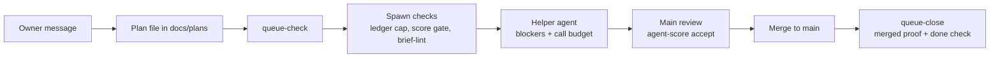

# neurastream

Guardrails for running many AI coding agents at once.

One "main" agent plans the work and reviews it; cheaper "helper" agents do the coding. neurastream is the set of checks between them. It keeps a queue of written plans, refuses helper actions a plan forbids, limits how many helpers run per provider, scores each helper by accepted work per dollar, and only lets a plan leave the queue once its branch is really merged.

The core does not depend on one agent tool. Adapters translate a tool's events into core calls. The first adapter is [omp](https://github.com/can1357/oh-my-pi).

A step-by-step visual walkthrough (50 steps, plain language) is in [docs/visual/neurastream-deck.html](docs/visual/neurastream-deck.html). Download it and open it in a browser.



## What it does

| Part | What it enforces |
|---|---|
| Queue (`queue-check`, `queue-close`, `queue-cancel`) | Every open plan is a file in a main checkout, listed in the one main index (`paths.queue_index`, one absolute path per line — never repo directories) and follows a template; one plan = one worktree. A plan leaves the queue only when its branch is merged into remote main and its done check passes; a failing check reopens it. Closing removes the plan's worktree when it is clean and its branch landed — a plain `git worktree remove`; a dirty, unmerged or unremovable worktree and the repo's main checkout are kept with the reason. Branches leave only via `git branch -d`, so a branch whose merge git cannot see stays. |
| Blockers | Each plan's phase 0 lists what helpers may not do: push, touch a path, run a command, or write a text. The guard judges the command that runs and the files it changes, not words inside commit messages, quoted text or heredoc bodies: `git commit -m "... push ..."` is allowed, `git push` is refused. |
| Guards | Helpers may only edit their plan's `## Progress`; every new entry ends with a `Findings:` line (`Findings: none`, or one item per finding with `file:line` evidence) or the edit is refused and the file restored, and each item becomes an incident. Helpers get a warning at call 90 and are stopped at call 100; Main can set a different stop for one run with a `Call budget: <N>` line in the task brief (see "Main reads the code for its plans" below). Protected files need an owner unlock (a file the owner touches, valid 30 minutes). With `guards.chat_unlock` on (default off), the owner's whole chat message `unlock` / `unlock N` / `lock` — typed in the terminal or through a collab guest prompt from a write peer — moves that file instead; nothing a model, a subagent or a tool produces can. |
| Ledger (`agent-ledger`) | Tokens, cost, state and exit reason per agent; `--cap` refuses a spawn when a provider already runs 2. |
| Scoring (`agent-score`) | Points only for work Main accepted by commit, times the phase difficulty. Ranked per dollar and per hour. |
| Brief lint (`brief-lint`) | Refuses a helper brief that misses a required rule (acceptance, stop condition, no push, call budget). |
| Machine health (`machine-guard`, `main-start`, `heavy-run`) | Load, free memory, disk and `/tmp` limits; one heavy test run at a time. |
| Unlanded work (`wip-check`, `wip-snapshot`, `wip-backup`) | Lists branches on no remote and dirty worktrees; snapshots them as hidden commits; can push them to a backup repo. |
| Session rollover | When the main session file passes 5 MB, the next owner message starts a fresh session from a handoff note. |
| Owner page (`neurastream ui`) | One phone-sized page over Tailscale (`ui.*` config): the plans waiting on the owner with answer buttons, the guard unlock, running agents, the queue, recent merges/CI, open incidents, agent scores, machine health. Serves only a tailnet peer whose `tailscale whois` login equals `ui.owner_login`, only with a Host header naming the tailnet address or the MagicDNS name — DNS rebinding and every other visitor get a 403. Answers land in the owner inbox and reach Main once each; agents cannot start the page or write the inbox. |

## Requirements

- [Bun](https://bun.sh) 1.x
- Runs on Linux and macOS.
- git
- omp, for the guards and rollover (the command-line tools work without it)

## Install

```sh
bun add -g neurastream
neurastream init
neurastream adapter install omp
neurastream doctor
neurastream uninstall --purge   # the inverse: removes it all again
```

`init` writes `~/.config/neurastream/config.yml` from the defaults in [docs/config.md](docs/config.md), plus an empty index, notes, the queue template, blocker wrappers, and the state directories. A second run changes nothing. `adapter install omp` links the extension (`~/.omp/agent/extensions` and `omp plugin link`). `doctor` exits 0 when the install matches the package and flags a main index that still lists repo directories (the old two-level queue). `neurastream queue migrate` folds that old layout into the one main index: each repo line's `INDEX.md` plans move into the main index, the repo files are deleted; it is idempotent and reports plans that still live inside a linked worktree instead of moving them. `uninstall` removes the installed bins, the plugin link, template-identical pins and the AGENTS.md block; `--purge` adds the config file and the agent-dir state. It prints the list first and refuses anything outside your HOME.

`init` also sets the subagent allow-list (`notes/subagents.md`, the `## Allowed` section). `neurastream init --allow a,b` adds those slugs on the first run and on later runs, and never removes one. Without `--allow`, a terminal run asks once: `Subagents allowed to spawn (comma-separated names, empty = none):`; a blank answer, or no terminal, leaves the list as it is. While the list is empty, init prints `no subagents allowed yet: neurastream agents allow <name>`. `neurastream agents list|allow|deny` changes it later. A slug must match `[a-z0-9-]+`; a bad one exits 2 and writes nothing.

The defaults are neutral (empty work roots, no backup remote, no default branch); set your own in `config.yml`. To try it without touching your real home, set `HOME=/tmp/neurastream-home-dev` first.

Check the merged result:

```sh
neurastream config --json
```

Every tool is one program, selected by the name it was called with: `agent-score`, `agent-ledger`, `brief-lint`, `oc-run`, `wip-check`, `wip-backup`, `wip-snapshot`, `main-health`, `queue-check`, `queue-close`, `queue-cancel`, `queue-trim`, `main-start`, `machine-guard`, `quota-reset`, `priority-watch`, `resource-alerts`, `tmp-snapshot`, `heavy-run`.

## Skill pack

`templates/skills/` ships skills for any agent that reads `~/.agents/skills/`. `neurastream adapter install omp` copies each one to `~/.agents/skills/<name>/` only when that directory is missing; an existing directory is kept as it is, so your edits survive a reinstall. `doctor` reports a shipped file that is missing from the live copy. `uninstall` removes a skill directory only when its whole tree is byte-identical to the shipped one; a directory with your own file or an edited file is kept and listed as `kept:`.

The first skill is `architecture-drilldown`: a self-contained HTML atlas with drill-down boxes. Its data is the `T` tree between `/* === DATA === */` and `/* === END DATA === */` in `template.html`; replace that block and leave the engine below it alone. `SKILL.md` lists the schema and the checks.

## Develop

```sh
bun install
bun run typecheck
bun test
```

Green is both exiting 0.

## Scoring details
### Trace efficiency

`neurastream traces efficiency --since 7d` reports wasted tool calls from recent traces; pass a run id to inspect one run, or add `--json` for machine-readable per-run records (including step indexes and matched rules). Waste rules cover repeated reads and failed commands, failed edits, repeated guard blocks and idle polling. The agent-score board adds `Calls/acc` and `Waste` columns; `score.waste_weight` (default `0`) scales ranking by the wasted-call fraction while leaving the default ranking unchanged.

`neurastream traces briefs --since 30d` lists each spawn brief Main sent (shared context first, then the task's own text) with its features — length, a `file:line`, a verify command, a phase id, a plan path, a `Call budget` line, the number of acceptance lines — next to the spawned agent's waste and whether its work was accepted. `--json` gives the rows, `--report` compares the rows with and without each feature (a side with fewer than `traces.briefs.min_n` rows prints "n too small"). Brief text never prints. Read the report with care: a spawn without a plan is never accepted, and accept records exist only since scoring began, so all-time accept rates mostly measure when and for what an agent was spawned, not how good the brief was. Compare plan briefs from the same period before turning a gap into a rule; on 30 days of real briefs that comparison showed no feature strong enough for a brief-lint warning.

`agent-score accept` records accepted work by commit; `agent-score validate <Agent> --plan <plan.md> --phase <P> --evidence <report.md> --section "<heading prefix>"` records a validation phase (checks/tests ran, report section written, no commits) with proof Main cannot fake by typing: the plan line must be ticked `- [x]`, the cited section body must name a heavy-run label run by that agent (from `paths.heavy_log`), and the phase must not be scored already. The ranking board counts it in `Accepted (diag/val)` as `N (d/v)`.

## Main reads the code for its plans

Owner rule: never write a plan when another agent is doing the research or reading for you. When Main writes a plan, Main reads the relevant code itself and lists those files in the plan.

- Logged: every non-`task` call Main makes adds the paths it touches to `main-reads.json` in the queue state dir (`paths.queue_state`), with the time. A `grep -n` result adds each file it names (`path:line:` at a line start), resolved against the call's directory.
- Window: `guards.plan_read_max_hours` (default 24, `docs/config.md`). Every file listed under `## Code read by Main` must exist and have a logged read within that many hours. A backticked path cited elsewhere in the plan, outside `docs/plans/`, must also be listed there.
- Cutoff: plans whose filename stamp is `20261021_0100` or later must carry a non-empty `## Code read by Main` section. Older plans are grandfathered.
- Retention: entries older than 7 days are dropped on each write.
- Spawn briefs: a brief must name an unticked phase id of the plan (for example `P4`). A brief that asks for research for a plan to be written is refused, quoting the owner rule.
- Call budget: a `Call budget: <N>` line in a task brief (the task's own text, or the shared `context` of the same `task` call; the task's own line wins) gives that run a hard stop at N calls, with the warning N − (`guards.sub_max_calls` − `guards.sub_warn_calls`) calls in, floored at 1. At the stop only plan Progress reads and edits pass, as at the global limit. N must be between 10 and `guards.sub_max_calls_cap` (default 200) and the task must carry a `name` — the budget is keyed by it in `<queue_state>/spawn-budgets.json` — or the spawn is refused with the allowed range. A task without the line keeps the global warn 90 / stop 100, and the ledger flags a still-running sub `OVER-BUDGET` past its own N.

## Queue holds

A plan parked for the owner has one line: `WAITING on owner: <what>`. That line is the only hold, and only Main writes it (plan-guard refuses subagents). The queue summary shows it as a flag on the plan, cut at 80 characters. Compaction and the rollover handoff read the same lines through `ownerHolds`: the compaction context lists each `<plan file>: WAITING on owner: <text>` line (or `none`) and says any other "needs the owner" or "paused" claim is unverified; the handoff's generated state carries the same lines. Main does not keep holds in a handoff note.

## Queue priority

`INDEX.md` order is priority: the top line is rank 1. The queue summary lists plans in that order (`N. <file> [flags] <goal>`). Before a spawn, the guard checks every plan above each plan the brief names. A higher plan that is idle — open, no `WAITING on owner:`, not awaiting merge, still has an unticked phase, and not itself waiting on another open indexed plan via a `Waits on: <plan>` line — and not staffed by a running job blocks the spawn unless the brief quotes the owner: `Priority skip: <plan> — owner: "<his words>"`, at least four words that appear in an owner message of the last 24 h (`<queue_state>/owner-messages.jsonl`, recorded from Main's prompts); any other skip line is refused. `Waits on:` lines are Main-only, like `WAITING on owner:`. Staffing is `<queue_state>/staffing.json` (each plan's newest spawn's task names) matched against omp's running job labels. The owner reorders the queue by dragging cards on the phone page.

## Owner page (`neurastream ui`)

`neurastream ui on --login <tailscale login> [--port N]` does the whole setup in one sentence: it writes `ui.enabled: true` and `ui.owner_login` (plus `ui.port` with `--port`) into `~/.config/neurastream/config.yml` — every other line of the file is kept byte-for-byte — copies `templates/systemd/neurastream-ui.service` to `~/.config/systemd/user/neurastream-ui.service`, runs `systemctl --user daemon-reload`, `enable` and `restart`, then prints the phone link `http://<MagicDNS name>:<port>`. The login must be one the tailnet knows (`tailscale status --json`); when tailscale cannot answer, the check is skipped with a printed warning, never a refusal. `neurastream ui off` stops and disables the unit and sets `ui.enabled: false`, keeping `ui.owner_login` for the next `on`.

With `ui.enabled: true` and `ui.owner_login` set (`neurastream config`, `docs/config.md`), `neurastream ui` serves one page bound to this machine's tailnet address only (port `ui.port`, default 7787; `templates/systemd/neurastream-ui.service` runs it as a user unit). The page reads top to bottom: a sticky status strip with the amber "needs you" count plus working/CI/disk signals that turn red only when something is actually wrong; one card per open `WAITING on owner:` plan — the plan's `#` title, the ask in plain words, the goal folded into a Background block, and named actions ("Yes, go ahead", "No", "Reply…") whose answer shows as a one-time receipt ("Sent to Main · 08:12"); a working-now row per running or waiting agent; and closed details blocks for the queue (one flat list in `INDEX.md` order — drag a card by its handle, or tap "↑ top"/"↑"/"↓"; the drop rewrites `INDEX.md`, Main gets the move as a message and the page confirms "Moved to #2"), merges/CI, incidents, agent scores (a real table) and machine health. A sticky bottom bar holds the guard unlock ("Unlock 15 min", "Unlock 30 min", "Lock now") and, when `guards.chat_unlock` is off, says so in plain words with the exact config line. Light and dark follow the OS; there are no external assets and no build step — one server-rendered HTML string, inline CSS and one small inline script under a per-response CSP nonce (`bun scripts/ui-preview.ts <out.html>` renders a preview without a server). No chat, no plan editing, no shell.

A request is served only when the peer is a tailnet address that is neither loopback nor this machine's own tailnet IP, `tailscale whois` names the `ui.owner_login` login — and the Host header is this machine: the tailnet address or the MagicDNS name, with the served port. The Host check runs on every request before whois, and a POST's Origin must match it, so a DNS-rebinding page (foreign Host, matching Origin, owner's phone) gets a 403 like everyone else. Every request logs one `UI <method> <path> login=<l> → <code>` line to the guard log.

An answer appends one record to `<queue_state>/owner-inbox.jsonl` (plan, question, answer, login); unlock/lock go through the core unlock and log `UNLOCK ui source=ui:<login> minutes=N`. Main's session delivers each record once as a user message — at turn end and on a 15 s poll while idle — and marks the consumed rows in `<queue_state>/owner-inbox.cursor`; subagent sessions never deliver. Both files sit under the queue state dir, so guards refuse agent writes to them: an agent cannot forge an owner answer. Guards also refuse agent commands that start the page (`neurastream ui`, or `systemctl --user start/restart/enable` of `neurastream-ui`): starting it is the owner's move.

## Session rollover

Main's session file grows with every turn. When it reaches `rollover.max_session_mb` (default 5, `docs/config.md`), Main writes a handoff note to `<queue_state>/rollover/<session id>.md`. The note covers the work in progress and its state, the decisions made and why, the next step, and the files involved. Main is asked for it once per session file, when a turn ends.

There are two modes:

- Under `neurastream main` (the launcher) the rollover is automatic. Once the note is written and no own jobs (subagents included) are still running, omp writes `relaunch.json` and exits. The launcher starts a fresh omp whose first message is the handoff: the note verbatim, the generated `main-start` state (including the owner holds), the owner's unsent draft if there is one, and a line that the owner is away. Nobody types anything. A handoff over 100000 bytes goes to `<queue_state>/rollover/<session id>.handoff.md`, and the first message points at that file.
- Under plain `omp` the switch is never automatic. The owner's next plain message closes the session and starts a fresh one; the fresh session opens with the note verbatim, the generated state, and then the owner's message.

A relaunch keeps the flags of the first run (`--model`, `--session-dir`, …) and drops only the first message and the session-picking and one-shot flags (`-r`, `-c`, `--restore`, `--goal`, `-p`, …), so the fresh omp stays on the same model and session directory.

In both modes:

- If omp does not exit within `rollover.exit_grace_s` seconds (default 20, `docs/config.md`) after a relaunch was requested, the adapter stops waiting and rolls over in-process: the fresh session opens in the same process and carries the owner's typed messages in its handoff. A real shutdown (`session_shutdown`) cancels the fallback.
- The relaunch is requested only when Main's run has really ended: a tool result mid-run never restarts the session, and while a relaunch is pending every later terminal run end calls `shutdown()` again (omp re-checks its deferred exit only then).
- The launcher prints one stderr line while it collects the handoff state (`neurastream: starting a new session from the handoff (collecting state, about a minute)…`) and removes the request only after the handoff message is built; a fresh `neurastream main` with no message of its own continues an interrupted rollover whose request is at most one hour old.
- A note counts only if it was written after the threshold was crossed and is at most one hour old.
- The running plugin going stale counts as over the threshold too: at every check the adapter re-reads the `package.json` it was loaded from, and a different (or unreadable) version asks for the handoff note even below `rollover.max_session_mb`, naming both versions (`NEURASTREAM_PACKAGE_JSON` overrides the path it watches).
- While a rollover is pending (no fresh note, own jobs still running, or the handoff is ready and waiting for idle), Main cannot start new subagents: a `task` call is refused until the running jobs finish and the session rolls over.
- While own jobs (subagents included) are still running, the switch waits: a rollover would cancel them.
- While a rollover is pending, the stop guard does not apply: Main may stop in `ready` or `wait-jobs`, and in `need-note` the stop is blocked only by the note request.
- `/main-rollover <message>` does the same by hand. It refuses below the threshold, without a fresh note, or while jobs run. Under neurastream main it is refused and the owner's next message starts the rollover; in plain omp a second call while one waits adds its text to the same handoff.
- `/main-rollover` shows a notice at once and gathers `main-start` in the background, so omp keeps repainting and reading keys until the new session opens.
- The previous session file stays where it is.
- `rollover.enabled: false` turns the feature off.

## Notify the owner

When Main's turn ends and the session stop hands back to the owner, neurastream posts Main's final reply to the configured chat channels — deterministic code in the adapter, no model call, no tokens, never forgotten. Discord, Slack, both, or neither: notify is off until a webhook file exists.

The webhook URL is a secret (anyone holding it can post as the bot), so it never goes into `config.yml`. The config holds the file's path only (`docs/config.md`):

```yaml
notify:
  discord_webhook_file: "~/.config/neurastream/secrets/discord-webhook"   # "" = off
  slack_webhook_file: "~/.config/neurastream/secrets/slack-webhook"       # "" = off
  prefix: ""                 # optional label prepended to each post, e.g. "Main:"
```

Set a channel up:

- Discord: Server Settings → Integrations → Webhooks → New Webhook → copy the URL.
- Slack: add the "Incoming Webhooks" app to your workspace → copy the webhook URL for your channel.

Then write the URL into its secret file — as the owner, in a terminal (the guard refuses agents; the examples show the path, never a URL):

```sh
umask 077
mkdir -p ~/.config/neurastream/secrets
printf '%s' '<url>' > ~/.config/neurastream/secrets/discord-webhook
chmod 600 ~/.config/neurastream/secrets/discord-webhook
```

Repeat for `slack-webhook`, then check:

```sh
neurastream doctor        # problems: a loose file mode, a raw URL in config.yml, a secret next to config.yml; warning: a missing file
neurastream notify test   # posts one line to every configured channel; exit 1 when one fails
```

Guard rules around it:

- No agent (Main included) can read a configured secret file, list its directory, or glob over it — unlock or not. Writes to the secret files and to `~/.config/neurastream/config.yml` need the owner's unlock like any guard file.
- A blocked stop still posts its final reply once when it has text; agent_end skips that blocked stop to avoid a duplicate. Every post is serialized in call order; Discord 429 responses wait for `retry_after` (or `Retry-After`, default 1 s; capped at 10 s) and retry the chunk once.
- Posts time out at 5 seconds per attempt. Long replies are split per channel (Discord 2000, Slack 3000 characters) on line boundaries where possible; failures are logged without delaying the stop decision.

"Needs you" pings use the same channels so the owner learns on the phone that a decision is his: when a Main turn ends with an open plan whose `WAITING on owner:` line was not pinged before, neurastream posts `🔔 Needs you — <plan>: <question>` (with the `neurastream ui` phone-page link when `ui.enabled: true`), and when the guard refuses a Main tool call because it touches a protected guard file, it posts `🔓 Main needs an unlock to continue (<file>)` — the unlock ping at most once per 30 minutes, each waiting question once until its line changes or disappears, remembered in `<queue_state>/notify-waiting.json`. Every decision logs one `notify: needs-you posted|skipped (<why>)` guard-log line.

## Provider rate limits

When a Main turn ends on a provider rate limit, neurastream waits it out instead of asking again straight into the limit. The stop guard sees the turn's error text, matches it against `guards.rate_limit.patterns` (default `["429", "rate_limit", "rate limit", "overloaded", "529"]`, case-insensitive) and, on a hit, allows the stop without consulting the normal stop rules or touching the idle-stop counters. The chat channels get one post per episode — `⏳ Main is rate limited by its provider until HH:MM (local); it resumes on its own.` — and exactly one resume timer is armed (replacing any earlier one). When the wait is over, the plugin gives Main a new turn: `main-guard: the provider rate limit is over (waited until HH:MM). Continue the queue where you stopped.`, and the guard log carries the whole story:

```
RATE-LIMIT stop: resume at 08:12 (35s, attempt 1)
notify: posted (rate-limit)
RATE-LIMIT resume: new turn sent (waited until 08:12)
```

The wait is the `retry-after-ms=<ms>` or `retry-after: <seconds>` the error text names (omp appends the provider's header to the error message), else `default_wait_s` (300). A turn the resume started that ends on a limit again is the same episode at attempt 2: the wait doubles, no second post. Any turn that ends without a limit ends the episode and disarms the timer. Every wait is clamped to `max_wait_s` (3600) before `slack_s` (15) is added on top. Your own message takes over and cancels the resume (`RATE-LIMIT resume cancelled: owner message`) when it starts a turn; a slash command or a handled input such as a chat unlock leaves the resume armed. A rate-limited deferred hand-back (an `agent_end` while an async job is pending) arms the same timer instead of logging "no reply text". The words and the waits live in `config.yml` (`guards.rate_limit`, `docs/config.md`); turns that did not end on a rate limit are unaffected.

omp retries a 429 itself while the provider's wait fits its `retry.maxDelayMs` (300000 ms by default); only a longer wait ends the turn (`Retry failed after 1 attempts: Provider requested 731000ms wait, exceeds retry.maxDelayMs`), and that turn end is what neurastream waits out.

## Provider reset times

Before Main reads a message, reset timestamps matching `quota.reset_pattern` are annotated with their local time, for example `reset at 2026-10-25 18:56:22 (= 2026-10-25 11:56:22 CET local)`. Set `quota.reset_tz` to the provider's time zone; an explicit zone or UTC offset in the message takes precedence.

## Trace claims (`neurastream traces claims`)

Agents' final reports assert results — "530 passed", "exit 0", commit SHAs, heavy-run labels, changed files. This command reads a run's trace (its session file, read-only) and checks each claim in the run's last assistant message against what the run's own tool activity shows: a count or exit code must appear in some tool output, a commit SHA must be printed by the output of a git command the run itself ran, a heavy-run label must appear in a quoted heavy-run call, and a changed path must be carried by an edit/write call or a shell write in the path's own command segment. A claim nothing shows becomes a `claim-unbacked` finding.

```
neurastream traces claims --since 24h            # every run touched in the window
neurastream traces claims NsTracesVerifyGlm      # one run, by id
neurastream traces claims --since 24h --json     # machine-readable
```

Known boundary: a report that cites other runs' work (Main quoting a subagent, a relaunched agent quoting its predecessor) can produce `claim-unbacked` findings that are true in this run's trace but provable only in the cited run's own trace.

## Provider honesty

Five rules check what came back against what was asked for, over one run's trace, read-only (`src/core/trace-provider.ts`):

- `model-swap`: the run announced a model (`model_change`) but an assistant message shows another model or another provider, or the run resolved the request to a fallback (`resolvedModelIsFallback`).
- `odd-response-id`: an assistant message's `responseId` misses the regex configured for its provider (`traces.provider.id_patterns`; a provider without an entry is not checked, and a message without a responseId is not checked).
- `unoffered-tool`: a toolCall for a tool the session never showed as offered — not in `traces.provider.allow_tools`, not in the request's own tool list (an http dump), and no result anywhere in the run other than an unknown-tool refusal (`Tool <name> not found`, `No such tool`, `Unknown tool`). An error result such as a guard refusal still proves the tool exists.
- `phantom-output`: output tokens billed for an assistant message that wrote nothing. A message whose stream was aborted (owner interrupt) or errored is not judged: the harness drops its partial content but keeps the usage of what streamed.
- `cost-mismatch`: the run's `model_usage` cost misses the `traces.provider.prices` table ($ per million tokens) by more than ±20%, in either direction; a model without a price row is not checked.

`neurastream metrics report` ends with a weekly line — `Provider honesty over N runs: …` — counting the findings of every run touched in the window. Both config maps are open: an empty object in the template means "add your own keys" in your config. The id patterns below were sampled from real traces; paste them (or yours) into `~/.config/neurastream/config.yml`:

```yaml
traces:
  provider:
    id_patterns:
      anthropic: '^msg_[A-Za-z0-9]+$'
      zai: '^[0-9]{14}[0-9a-f]+$'
      openai-codex: '^resp_[0-9a-f]+$'
      openrouter: '^gen-[0-9]+-[A-Za-z0-9]+$'
    prices: {}   # e.g. glm-test: { input: 2, output: 6, cache_read: 0.2, cache_write: 0.5 }
    allow_tools: []
```

Finding evidence is masked (long token-like runs never survive verbatim) and capped at 160 characters, so a response id or a tool call line cannot carry a secret into the findings.

## Prompt bloat (`neurastream traces bloat`)

`neurastream traces bloat [--since 24h] [--json]` (or one run by id) lists, per run, every model call's prompt — `usage.input + usage.cacheRead + usage.cacheWrite`, one row per call — and flags `prompt-bloat` when

- the run's FIRST call opens over `traces.bloat.first_call_max` (a run that starts huge stays huge), or
- any call passes `traces.bloat.ratio_of_limit` × its model's `traces.bloat.context_limits` entry (an open map; a model without an entry is not limit-checked).

A failed request dump under `~/.omp/logs/http-400-requests` (named `<epoch-ms>-<id>.json`) belongs to one run only: its trace window must cover the dump, its model must match, and among eligible runs the closest event timestamp at or before the dump wins. An exact tie—or no eligible run—leaves the dump unmatched; text and `--json` output list unmatched dumps once. For the owning run, the report shows what filled the prompt: system, messages and tool groups (tools grouped by the first capture of `traces.bloat.tool_group` on the tool name; no match = `builtin`) plus the five largest individual tools.

A rejected call never wrote usage, so a run can carry a 1.17M-token prompt with no usage row and no finding of its own. When a run has no usage finding, the matched dump's error response is read: a stated prompt size ("prompt is too long: 1172629 tokens > 1000000 maximum") becomes the flag, with the dump named as the source. A dump whose error response states no count flags nothing, and no size is ever guessed from bytes.

`neurastream metrics report` ends with a weekly line — `Prompt bloat over N runs: K flagged, largest first call X tokens (<run>)` — over every run touched in the window (largest first call = the run's usage, else the matched dump's stated prompt). The agent ledger shows a `tok/call` column: prompt tokens ÷ calls per run.

Config (defaults):

```yaml
traces:
  bloat:
    first_call_max: 150000
    ratio_of_limit: 0.8
    context_limits: {}   # e.g. claude-opus-5-5: 1000000
    tool_group: '^_?mcp__([A-Za-z0-9]+)_'
```

## Self-metrics

`neurastream metrics report [--days N]` compares this window (the last `metrics.report_days`, default 7) with the one before it, writes `<paths.notes>/metrics.md`, and prints the same report. Worst change is marked `◀ worst`. The five numbers:

- M1 cost per merge: cost of sub and main runs written in the window, divided by accepts in the window. Worker-only and Main-only dollars are shown too.
- M2 idle calls: calls of finished or died sub runs in the window that never got an accept, diagnose or validate event. Top 3 shown.
- M3 CI tries: mean `tries` of `ci` events in the window, and the MRs at 3 or more tries. Tries come from `metrics.ci_pipelines_cmd` (see `docs/config.md`).
- M4 owner corrections: owner messages in main runs that match `metrics.correction_patterns`, and Main messages ending in `?`. The owner message count is shown but never ranked.
- M5 guard blocks: BLOCK lines in the guard logs in the window, with false alarms and the top 3 reasons.

Caveat: M4 is a whole-run measure. A main run counts entirely by its last write time, so a run that spans a window edge counts in the window it ends in.

The report ends with a `Provider honesty over N runs: …` line — provider-honesty findings (see Provider honesty above) over every run touched in the window — and a `Prompt bloat over N runs: …` line (see Prompt bloat above) over the same runs.

Weekly loop: run `neurastream metrics report`, then propose ONE rule change to the owner. When the owner decides, record it with `neurastream metrics rule "<text>" --approved|--rejected`; approved rules get a before/after check once a full window has passed. Record CI with `neurastream metrics ci <repo-dir> <mr-id>` and guard false alarms with `neurastream metrics false-alarm <log-ts> --why "<text>"`. main-start shows the report as due when it is missing or older than `metrics.report_days`.

## Self-improvement

Bugs in neurastream itself are found by code, written to a persistent list, and pushed on Main until each one has a plan or a recorded dismissal — not remembered. The list is `<paths.queue_state>/incidents.jsonl`; `neurastream incident list [--open] [--json]` reads it.

Five sources feed it:

- Real time (at Main's prompt and after each Main bash result): a finished subagent the agent-ledger still shows RUNNING/WAITING past `incidents.contradiction_grace_min` (D1); a neurastream tool that crashed in a Main bash result (D2); the same guard block firing `incidents.block_repeat` times within one hour (D3); an owner message matching `metrics.correction_patterns` (D4). D2 and D4 run on every event; D1 and D3 read the session files and the guard logs at most once per `incidents.scan_interval_sec` (state: `incident-scan.json` in the queue state dir).
- Daily: at the first main-start or Main prompt of a day, M1-M5 for the last 24 hours against the mean of the 7 days before; a metric worse by `incidents.daily_worse_pct` and above its `incidents.daily_floor` floor is an incident.
- Weekly: when the metrics report is due, the code writes `<paths.notes>/metrics.md` itself and its worst ranked metric becomes an incident.
- Main itself: `neurastream incident add "<summary>" --kind <k>`.
- A subagent's plan work: every new `## Progress` entry in a plan ends with a `Findings:` line (`Findings: none`, or one item per finding — bug, workaround, improvement, any repo — with `file:line` evidence, items separated by `;`). The plan-guard refuses and restores an entry without the line, and each item of an allowed edit becomes an incident (source `findings`, evidence = plan path + agent); the same text again dedupes into the open incident.

While an incident is open (no plan, dismissal or fixed record), every Main prompt carries one `INCIDENT <id> [<source>/<kind>]: <summary>` line per open incident, Main's `task` spawns and bypass launches are refused unless the brief names a plan citing `INCIDENT <id>`, and Main cannot stop with an incident that has neither. The loop closes three ways: `neurastream incident plan <id> <plan.md>` (the plan must exist, be listed in the main index, cite `INCIDENT <id>`, and carry a fail-before phase — its regression test has to fail on the old code), `neurastream incident dismiss <id> --why "<text>"`, and `fixed` — written by the queue itself when it closes a plan that cites the incident. `neurastream metrics report` shows M6: incidents opened / planned / dismissed / fixed and the median hours from open to fixed.

## Changing a script

Edit the script in this repo. Green is `bun run typecheck` and `bun test`, both exit 0. Main tags the release. The publish workflow puts that tag on npm. Then:

```sh
bun add -g neurastream@latest
neurastream adapter install omp
```

Live copies are never hand-edited. `neurastream doctor` names each hand-edited installed file and each missing one (`missing:`), and a stale install (the installed version is not `npm view neurastream version`). If the registry cannot be reached, that check is a warning, not a failure.

## AGENTS.md block

`adapter install omp` writes the neurastream orchestrator rules into `~/.omp/agent/AGENTS.md`, between the markers `<!-- neurastream:begin (managed by neurastream; edit the package, not this block) -->` and `<!-- neurastream:end -->`. The rules come from `templates/AGENTS.md`; the agent dir comes from your config.

- Managed: the text between the markers. Install replaces it. A second install changes nothing.
- Yours: every line outside the markers. Install keeps it byte for byte. A file with no markers gets the block appended.
- Drift: `neurastream doctor` reports `stale:` when the text between the markers differs from the package's block, and `missing:` when the markers are absent. Edits outside the markers are never reported.
- Edit limit: the project-file changes Main gets per window come from `guards.main_edit_limit` and `guards.main_window_min`, not from the block text.

## License

MIT. See [LICENSE](LICENSE).
