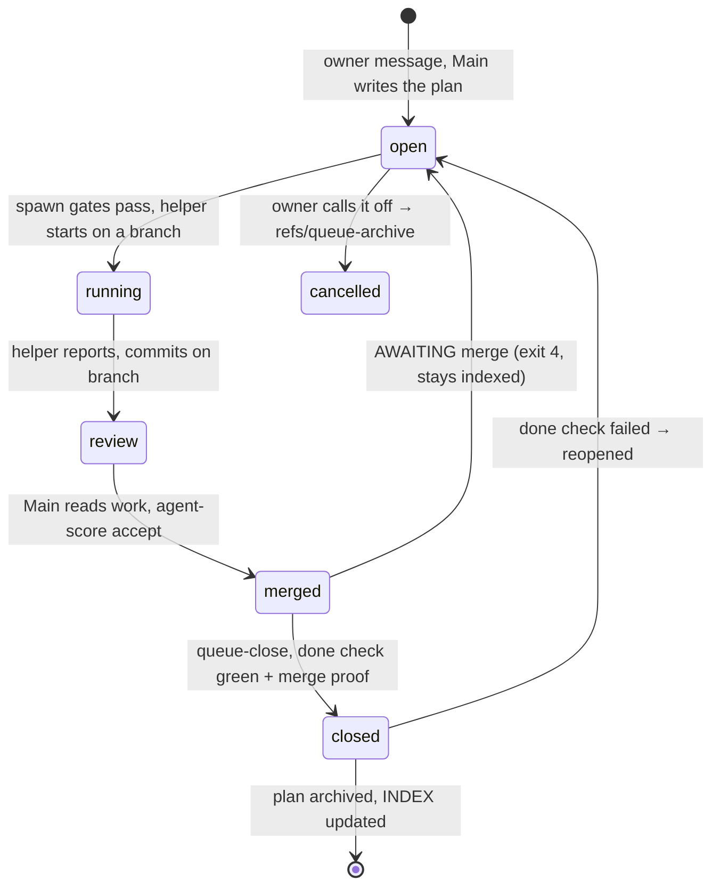

# The queue lifecycle — one page

Review aid: how an owner's message becomes merged, archived work, and how failures feed the next plan.

## The plan's state machine

## What refuses what

| Gate | Refuses when | Result |
|---|---|---|
| Spawn checks | plan not open, no new `## Progress` since last run, provider full (2/2), agent over 100 calls | no helper starts |
| Guard (per call) | command/path/text matches plan `Forbidden`, protected guard file, edit outside `## Progress` | call refused, plan restored |
| no-push blocker | any `git push`/merge by a helper | helpers commit only, Main pushes |
| agent-score accept | commits not on the branch | no points recorded |
| queue-close | done check red → reopen (exit 1); not merged → AWAITING (exit 4) | plan stays indexed |

## The invariants (say these in the interview)

1. **Subagents never push or merge.** One integration owner (Main); one MR pipeline at a time.
2. **Verify, never trust.** "Landed" lines are checked against Git; merged needs one of three proofs; done checks re-run on close.
3. **Nothing counts unreviewed.** Points only after Main reads commits against the plan's Progress.
4. **Guards block by invariant, not by mood.** Per-call blockers block *new* violations (changed ∩ shipped); strict whole-tree checks live in the Done check — a guard that can never pass is a deadlock, not safety.
5. **The loop closes.** Every incident is dismissed with a reason or fixed by a plan; a published leak became the scrub plan became 0.1.24.
6. **Budgets are explicit.** Main: 5 project-file edits / 15 min. Helpers: 100 calls (warn at 90). Providers: 2 running each. Unpublish: 72 h registry window.

## One sentence

> An owner's words become a plan; guards let helpers work without letting them break the system; only verified, merged work leaves the queue; and anything that leaks, fails or refuses comes back in as the next plan.
